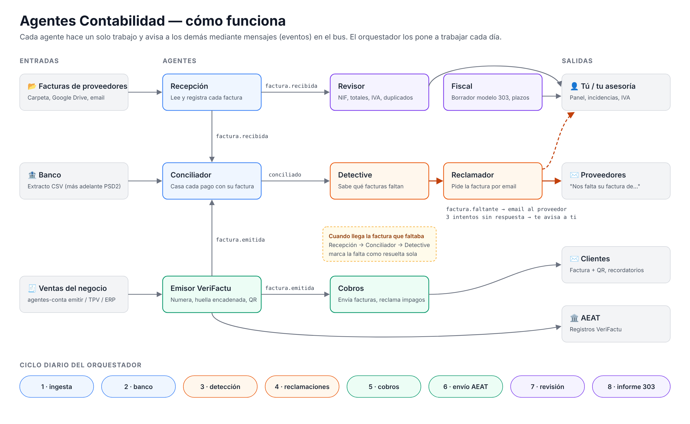
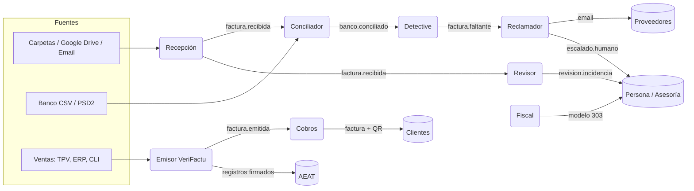

# Agentes Contabilidad

**Un equipo de agentes de IA que lleva la contabilidad de un pequeño negocio y lo deja preparado para VeriFactu.**

Cada agente tiene un único trabajo y se comunica con los demás a través de un bus de mensajes. Entre todos se encargan de lo que hoy se hace a mano o acaba en la asesoría: saber qué facturas faltan, pedírselas a los proveedores, emitir las facturas de venta con huella y QR, enviarlas a los clientes, casar el banco, revisarlo todo y preparar el IVA trimestral.

> **Estado:** MVP funcional (v0.1). El núcleo VeriFactu reproduce el ejemplo oficial de huella de la AEAT, pero el envío real a la AEAT todavía no está terminado (ver [Roadmap](docs/roadmap.md)). No lo uses en producción sin la revisión de un asesor y sin homologar el software.

## El ecosistema



<details><summary>Diagrama de eventos (Mermaid)</summary>



</details>

| Agente | Qué hace | Se entera de… | Avisa a… |
|---|---|---|---|
| **Recepción** | Lee documentos de carpetas, Drive o email y registra las facturas de proveedores (JSON, texto, PDF; con Claude si hay API key) | `documento.recibido` | `factura.recibida` |
| **Conciliador** | Importa el banco y casa cada cobro/pago con su factura | `banco.movimiento`, `factura.*` | `banco.conciliado` |
| **Detective** | Siempre sabe **qué facturas faltan**: pagos sin factura y proveedores recurrentes sin factura del mes | `banco.conciliado`, `factura.recibida` | `factura.faltante`, `factura.faltante_resuelta` |
| **Reclamador** | **Escribe a los proveedores** para pedir las facturas que faltan; reintenta y escala a una persona | `factura.faltante` | `reclamacion.enviada`, `escalado.humano` |
| **Emisor VeriFactu** | Valida, numera, calcula la huella encadenada y el QR, y remite los registros a la AEAT | `factura.a_emitir` | `factura.emitida` |
| **Cobros** | Envía cada factura emitida al cliente (**facturas por enviar**) y reclama las vencidas | `factura.emitida` | `factura.enviada` |
| **Revisor** | **Comprueba el trabajo de los demás**: NIF, totales, IVA, duplicados, numeración sin huecos, cadena VeriFactu íntegra | `factura.recibida` | `revision.incidencia` |
| **Fiscal** | Calcula el borrador del modelo 303, vigila plazos y avisa si faltan facturas que afectan al IVA | — | `fiscal.informe` |
| **Orquestador** | Monta el equipo, lanza el ciclo diario por fases y responde preguntas en lenguaje natural | — | — |

El ciclo diario recorre estas fases: `ingesta → banco → deteccion → reclamaciones → cobros → envio_aeat → revision → informe`.

## Prueba rápida

Requiere Python 3.10 o superior. El núcleo no tiene dependencias externas.

```bash
git clone https://github.com/Abeelgutiierrez/Agentes-Contabilidad.git
cd Agentes-Contabilidad
pip install -e ".[dev]"

agentes-conta demo        # simula dos días de trabajo de una cafetería ficticia
agentes-conta agentes     # lista los agentes y su rol
pytest -q                 # 21 tests
```

### En Windows (PowerShell)

```powershell
cd "$HOME\asistentes contabilidad\Agentes-Contabilidad"
py -m venv .venv
.\.venv\Scripts\Activate.ps1      # si da error de permisos: Set-ExecutionPolicy -Scope CurrentUser RemoteSigned
pip install -e ".[dev]"
agentes-conta demo
```

La demo usa los datos de `examples/`: facturas en una carpeta (una duplicada, otra con el total mal y un documento que no es una factura), un extracto bancario con pagos sin factura y ventas con VeriFactu. Verás cómo el detective encuentra las facturas que faltan, el reclamador escribe a los proveedores, el revisor abre incidencias y, cuando llega la factura que faltaba, la falta se cierra sola.

## Uso con tus datos

1. Copia `examples/config.json` y adáptalo: datos de la empresa, proveedores y clientes (marca como `recurrente` el alquiler, los suministros, etc.) y conectores. `examples/config.produccion.ejemplo.json` muestra Drive, IMAP, SMTP y AEAT.
2. Copia `.env.example` a `.env` con tus claves. En el JSON, los valores que empiezan por `$` se leen de variables de entorno.
3. Programa el ciclo diario (cron o el Programador de tareas de Windows):

```bash
agentes-conta ciclo --config mi_config.json --exportar estado.json
agentes-conta emitir --config mi_config.json --factura examples/factura_venta.json
agentes-conta verificar --db datos_runtime/verifactu.sqlite
agentes-conta preguntar --config mi_config.json "¿Qué facturas me faltan y cuánto IVA pago este trimestre?"
```

Extras opcionales: `pip install -e ".[ia]"` (Claude para leer facturas, redactar correos y responder preguntas), `.[pdf]`, `.[qr]`, `.[google]`, `.[aeat]` o `.[todo]`. Sin `ANTHROPIC_API_KEY` todo funciona con reglas y plantillas.

## Estructura

```
src/agentes_contabilidad/
├── bus.py              # bus de mensajes y catálogo de eventos (contrato entre agentes)
├── models.py           # Factura, Tercero, MovimientoBancario, FacturaFaltante, Incidencia…
├── libro.py            # estado contable compartido (persistido entre ejecuciones)
├── llm.py              # Claude con modo sin IA
├── config.py           # monta el ecosistema desde un JSON
├── agents/             # un fichero por agente + orquestador
├── connectors/         # documentos (carpeta, Drive, IMAP), banco, correo, AEAT
└── verifactu/          # huella encadenada, QR, registros inalterables, XML, validación de NIF
```

## Documentación

- [Arquitectura y cómo añadir un agente o un conector](docs/arquitectura.md)
- [VeriFactu: qué cubre el proyecto y qué falta](docs/verifactu.md)
- [Roadmap](docs/roadmap.md)

## Aviso

Este software ayuda en la gestión, pero no sustituye al asesoramiento fiscal profesional. Para comercializarlo como Sistema Informático de Facturación, el productor debe emitir la declaración responsable que exige el Real Decreto 1007/2023.
