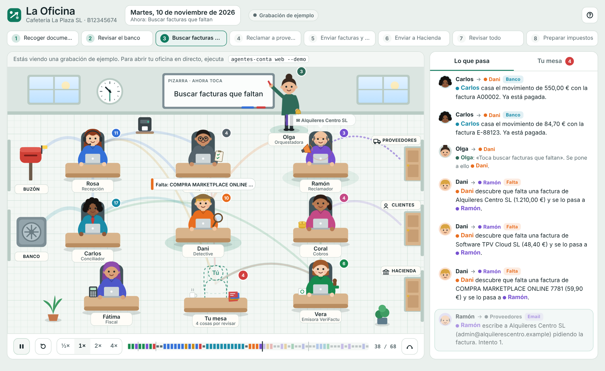

# La Oficina: el panel visual



La Oficina enseña el ecosistema como lo que es: un equipo de personas que se pasan trabajo. Cada agente tiene nombre, cara y mesa, y cada mensaje del bus vuela de una mesa a otra mientras pasa.

## Cómo abrirla

```bash
agentes-conta web --demo                 # cafetería de ejemplo, en directo
agentes-conta web --config mi_config.json  # tu negocio
```

Se abre el navegador en `http://127.0.0.1:8765/`. El panel solo escucha en tu ordenador.

Si abres `src/agentes_contabilidad/web/static/index.html` directamente (sin servidor), verás una **grabación** de la demo. Para regenerarla:

```bash
agentes-conta traza --demo -o src/agentes_contabilidad/web/static/traza_demo.js
```

## Qué se ve

| En la oficina | Qué significa |
|---|---|
| Personas en sus mesas | Un agente por mesa. La luz verde bajo la mesa indica que está trabajando. El número es cuántos mensajes ha enviado y recibido. |
| Olga y la pizarra | El orquestador. Escribe en la pizarra la fase del día y avisa a quien le toca. |
| Reloj y ventanas | La hora avanza con las fases; al terminar la jornada se hace de noche. |
| Buzón y banco (izquierda) | Por donde entra la información: facturas y movimientos. |
| Puertas (derecha) | Por donde sale: emails a proveedores y clientes, registros a Hacienda. |
| Tu mesa (abajo) | Las notas que el equipo no puede resolver sin ti. |
| Aviones, sobres, monedas, sellos y notas | Los mensajes. El color es el tipo: azul documento, turquesa banco, naranja falta, violeta email, verde VeriFactu, rojo error, ámbar aviso. |

A la derecha, **Lo que pasa** cuenta lo mismo como una conversación; al pulsar un mensaje se abre el email, la factura, la huella VeriFactu o el movimiento del banco. **Tu mesa** reúne las notas, las facturas que faltan, el borrador del 303 y la cadena VeriFactu.

En directo puedes:

- **Empezar jornada** en el día que elijas (para ver reclamaciones repetidas, salta una semana).
- **Nueva venta**: Vera la emite con VeriFactu y Coral se la envía al cliente.
- **Llega una factura** (demo): entra una factura que faltaba y el equipo cierra la falta solo.
- **Hecho** en una nota de tu mesa, para marcarla como revisada.

## Cómo está hecho

```
bus.py ──► trazas.py (Trazador) ──► web/servidor.py (API JSON) ──► web/static/oficina.js (SVG animado)
                     └──────────► web/traza.py (grabación .js/.json)
```

- `trazas.py` escucha todo el bus y convierte cada mensaje en un **evento de tráfico**: quién lo envía, quién lo recibe, tipo, una frase en castellano y los detalles. En la frase, `{detective}` es un hueco que el panel cambia por «Dani».
- `web/servidor.py` usa solo la biblioteca estándar. Rutas: `GET /api/info`, `GET /api/eventos?desde=N`, `GET /api/estado`, `POST /api/jornada`, `POST /api/venta`, `POST /api/llega-factura`, `POST /api/resolver`.
- `web/static/` no tiene dependencias ni paso de compilación: `index.html`, `oficina.css` y `oficina.js`.

### Añadir la mesa de un agente nuevo

1. Crea el agente (ver [arquitectura.md](arquitectura.md)). Su tráfico aparece solo en el panel y en el feed.
2. Para darle cara y sitio, añade una entrada en `PERSONAS` de `oficina.js` con nombre, puesto, colores, peinado, accesorio y posición `x, y` en la escena (1000 × 640).
3. Si publica un tema nuevo, añade su frase en `describir()` de `trazas.py`.
