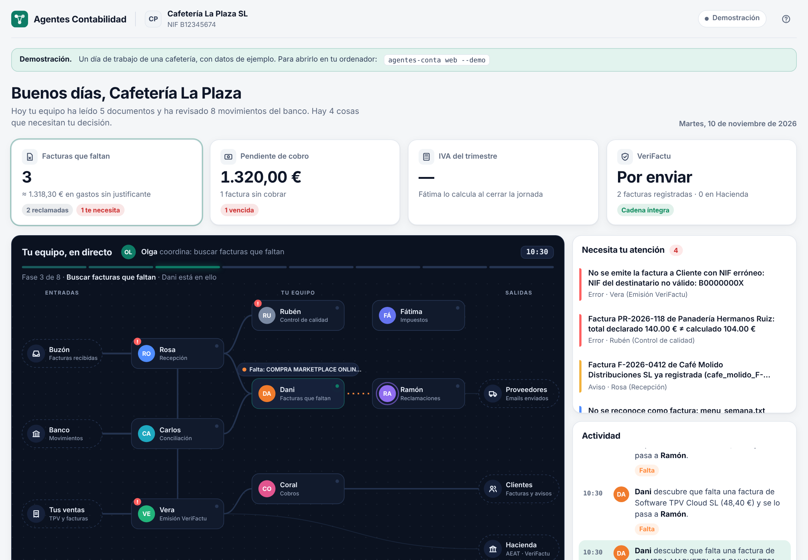

# El panel



El panel está pensado para el dueño de un pequeño negocio (un bar, una cafetería, una inmobiliaria), no para un contable. Se lee de arriba abajo:

1. **Saludo y resumen del día**: qué ha hecho el equipo hoy y cuántas cosas necesitan tu decisión.
2. **Cuatro cifras**:
   - **Facturas que faltan**: pagos sin justificante y proveedores habituales que no han enviado la del mes.
   - **Pendiente de cobro**: facturas emitidas que el cliente aún no ha pagado, y cuáles están vencidas.
   - **IVA del trimestre**: borrador del modelo 303 y días que quedan para presentarlo.
   - **VeriFactu**: facturas registradas, enviadas a Hacienda y si la cadena está íntegra.

   Cada tarjeta se abre para ver el detalle.
3. **Tu equipo, en directo**: un mapa con las entradas (buzón, banco, tus ventas), los ocho agentes y las salidas (proveedores, clientes, Hacienda). Cada mensaje viaja como un pulso de luz del color de su tipo. Arriba, la fase del día que coordina Olga.
4. **Necesita tu atención**: solo lo que el equipo no puede resolver sin ti, con una explicación de qué hacer.
5. **Actividad**: cada paso del equipo contado en una frase. Al pulsarlo se abre el email, la factura o la huella VeriFactu.

## Cómo abrirlo

```bash
agentes-conta web --demo                    # cafetería de ejemplo, en directo
agentes-conta web --config mi_config.json   # tu negocio
```

Se abre el navegador en `http://127.0.0.1:8765/`. El panel solo escucha en tu ordenador.

En directo puedes **ejecutar la jornada** del día que elijas, crear una **nueva factura** (Vera la registra con VeriFactu y Coral se la envía al cliente), **simular una factura recibida** (solo en la demo) y marcar los avisos como **hechos**.

Si abres `src/agentes_contabilidad/web/static/index.html` sin servidor, verás una demostración grabada. Para regenerarla:

```bash
agentes-conta traza --demo -o src/agentes_contabilidad/web/static/traza_demo.js
```

## Cómo está hecho

```
bus.py ──► trazas.py (Trazador) ──► web/servidor.py (API JSON) ──► web/static/app.js (HTML + SVG)
                     └──────────► web/traza.py (grabación .js/.json)
```

- `trazas.py` convierte cada mensaje del bus en un evento: quién lo envía, a quién, de qué tipo, una frase en castellano y los detalles con sus importes.
- `web/servidor.py` usa solo la biblioteca estándar. Rutas: `GET /api/info`, `GET /api/eventos?desde=N`, `GET /api/estado`, `POST /api/jornada`, `POST /api/venta`, `POST /api/llega-factura`, `POST /api/resolver`.
- `web/static/` (`index.html`, `app.css`, `app.js`) no tiene dependencias ni paso de compilación. Funciona en modo claro y oscuro, y en el móvil.

### Personalizar

- **Marca y colores**: los tokens de `:root` al principio de `app.css` (`--accent` es el color de la marca).
- **Un agente nuevo**: añádelo a `AGENTES` en `app.js` con nombre, rol, color y posición en el mapa (1100 × 580), y sus conexiones habituales a `RUTAS`.
- **Textos de «Qué hacer»**: el diccionario `QUE_HACER` de `app.js`, por código de aviso.
